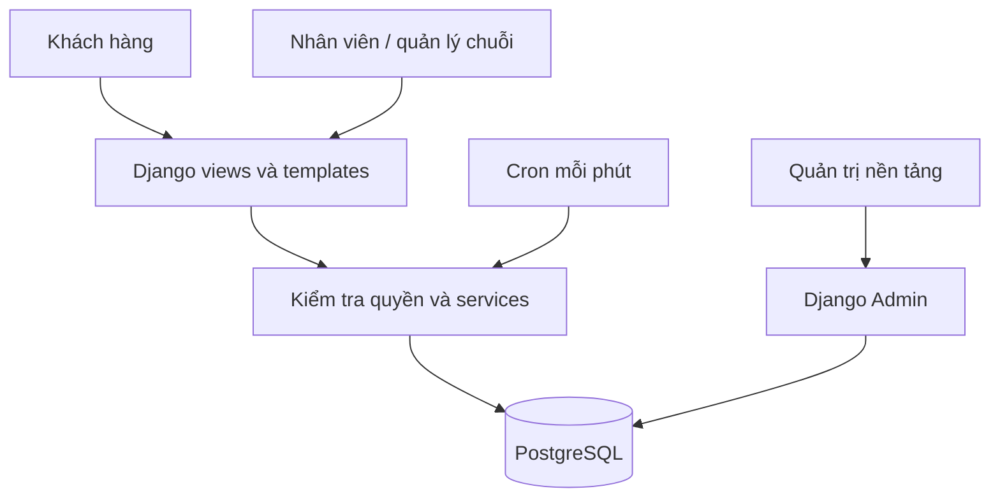
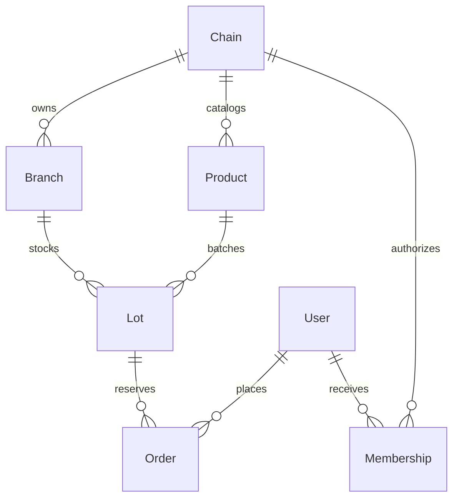

# Food Rescue — Hệ thống giảm lãng phí thực phẩm

> **Trạng thái hiện tại: chuẩn bị cấu trúc dự án, chưa triển khai nghiệp vụ mới.**
> Các file khung cho nghiệp vụ mới chỉ chứa ghi chú TODO, chưa được nối vào settings hoặc URL hiện có.
> Mục 1–11 là đặc tả và kế hoạch triển khai sau này; không phải xác nhận các chức năng đã hoạt động.
> Xem mục 12–13 để biết cấu trúc thư mục, trách nhiệm từng file và nguyên tắc viết code về sau.
> Đã áp dụng giao diện mẫu phase 1–2 từ `food_rescue_ui_refactor_phase12.zip`: trang Top tiếng Nhật và các trang mẫu cho cửa hàng. Xem mục 14; nghiệp vụ Food Rescue mới vẫn chưa được triển khai.

Ứng dụng Django cho chuỗi siêu thị/cửa hàng tiện lợi đăng thực phẩm gần hết hạn. Khách đặt online, đến đúng chi nhánh nhận hàng và thanh toán tại quầy. Bản MVP không thu tiền online, không giao hàng.

## 1. Phạm vi và giả định

- Giao diện tiếng Việt; tiền tệ mặc định VND, múi giờ Asia/Ho_Chi_Minh, có thể cấu hình bằng biến môi trường.
- Một đơn = một lô hàng tại một chi nhánh, số lượng do khách chọn. Giỏ nhiều sản phẩm là giai đoạn sau.
- Nhân viên nhập lô hàng thủ công. Chưa tích hợp POS, ERP hay tự động đọc hạn dùng.
- Lô hàng tự xuất hiện khi được bật và đang trong thời gian cho phép đặt. Hạn đặt < hạn nhận ≤ hạn sử dụng.
- Đơn giữ hàng đến hạn nhận của lô. Khách được hủy trước hạn nhận; quá hạn hệ thống chuyển EXPIRED.
- Hàng hết hạn sử dụng không được đặt hoặc giao, kể cả khi tác vụ dọn đơn chạy chậm.
- Không tự suy diễn thực phẩm an toàn dựa vào ngày hạn: bên bán chịu trách nhiệm dữ liệu, bảo quản, dị ứng và thu hồi. Phân biệt use-by/best-before trong thông tin sản phẩm.

## 2. Vai trò và phân quyền

| Vai trò | Quyền |
|---|---|
| Khách | Đăng ký, đăng nhập, tìm hàng, xem chi tiết, đặt và hủy đơn của mình |
| Nhân viên chi nhánh | Tạo lô từ danh mục sản phẩm của chuỗi, xem đơn chi nhánh, xác nhận thanh toán và giao hàng bằng mã nhận |
| Quản lý chuỗi | Có quyền vận hành tại mọi chi nhánh thuộc chuỗi được giao; xem báo cáo trong phạm vi đó |
| Quản trị nền tảng | Django Admin: tạo chuỗi, chi nhánh, sản phẩm và gán quyền; vận hành mọi chi nhánh |

MVP quản lý danh mục, chi nhánh và phân quyền qua quản trị nền tảng. Trang tự quản lý cơ cấu và nhân viên cho quản lý chuỗi là phần mở rộng. Không dùng is_staff để cấp quyền thao tác các chuỗi; chỉ superuser dùng Admin. Phân quyền theo đối tượng áp dụng phía server.

## 3. Kiến trúc

Django monolith: Templates + Forms + session authentication → views → services giao dịch → ORM → PostgreSQL. SQLite dành cho demo và kiểm thử chức năng. Không cần Redis/Celery ở MVP; cron gọi management command mỗi phút để đóng đơn quá hạn.



## 4. Mô hình dữ liệu

| Bảng | Dữ liệu chính |
|---|---|
| User | Django auth, tài khoản và mật khẩu băm |
| Chain | Tên chuỗi |
| Branch | Chuỗi, tên chi nhánh, địa chỉ |
| Membership | Người dùng, chuỗi, chi nhánh (trống = quản lý chuỗi) |
| Product | Chuỗi, tên, mô tả, thành phần/dị ứng, bảo quản, loại hạn, URL ảnh |
| Lot | Sản phẩm, chi nhánh, mã lô, giá gốc/giảm, lượng còn có thể đặt, mở bán, đóng đặt, bắt đầu/kết thúc nhận, hạn dùng, bật bán |
| Order | UUID nội bộ, khách, lô, số lượng, giá chốt, mã nhận UUID, trạng thái, hạn nhận chốt, thời điểm đặt/thanh toán, người giao |



Giá, số lượng và hạn nhận được chốt trên đơn. Hạn dùng lô luôn được kiểm tra thêm tại thời điểm giao. Không cho sửa lô đã có đơn qua Admin; điều chỉnh/thu hồi cần quy trình riêng trước production. Các quan hệ giao dịch dùng PROTECT để giữ lịch sử.

## 5. Luồng nghiệp vụ và bất biến

1. Nhân viên tạo lô hợp lệ của chi nhánh được phân quyền; chọn sản phẩm cùng chuỗi.
2. Khách lọc từ khóa/chi nhánh; chỉ thấy hàng đang bán, còn lượng và chưa đóng nhận đơn.
3. POST đặt hàng kiểm tra đăng nhập, CSRF, số nguyên dương. Trong transaction, khóa lô, kiểm tra thời gian và tồn; giảm lượng và tạo đơn cùng giao dịch. Token request UUID chống tạo đơn hai lần khi gửi lại cùng form.
4. Khách trình mã nhận tại chi nhánh. Nhân viên kiểm tra mã, thời gian nhận, quyền chi nhánh, trạng thái; thu tiền tại quầy rồi bấm xác nhận **đã nhận tiền và giao hàng**. Không thu tiền tự động.
5. Hủy/EXPIRED chỉ chuyển từ RESERVED và hoàn tồn đúng một lần, trong transaction. Tồn được hoàn nhưng lô hết thời gian vẫn không xuất hiện.

Trạng thái: RESERVED → COLLECTED hoặc CANCELLED hoặc EXPIRED. Chỉ COLLECTED có paid_at và collected_by. Không chuyển ngược. Khóa theo thứ tự Lot → Order để giảm deadlock. Lệnh dọn chạy lặp lại an toàn. Giá sử dụng Decimal, không dùng float.

## 6. Trang và endpoint

| Method / path | Mục đích |
|---|---|
| GET / | Danh sách và tìm kiếm lô |
| GET /lots/<id>/ | Chi tiết, thông tin bảo quản/dị ứng và biểu mẫu đặt |
| POST /lots/<id>/reserve/ | Giữ hàng, tạo đơn |
| GET/POST /signup/ | Đăng ký khách |
| /accounts/login/ | Đăng nhập |
| POST /accounts/logout/ | Đăng xuất |
| GET /orders/ | Đơn của khách |
| POST /orders/<uuid>/cancel/ | Hủy đơn của khách |
| GET /staff/ | Đơn và số liệu trong phạm vi được cấp quyền |
| GET/POST /staff/lots/new/ | Tạo lô hàng |
| POST /staff/orders/<uuid>/collect/ | Xác nhận mã, nhận tiền và giao hàng |
| /admin/ | Quản trị nền tảng |

Không có API công khai/DRF trong MVP; đây là ứng dụng HTML server-rendered hoàn chỉnh cho các luồng trên.

## 7. Quy trình chạy dự kiến sau khi triển khai

Yêu cầu Python 3.11+.

Các bước dưới đây là mục tiêu cho bản có nghiệp vụ hoàn chỉnh. Hiện tại `market` chưa được đăng ký, `seed_demo` và `expire_orders` chỉ là file ghi chú; chưa thể dùng hai lệnh này. Chưa có migrations cho các mô hình nghiệp vụ mới. Mã nguồn và migrations tài khoản có sẵn được giữ nguyên.

```bash
python -m venv .venv
# Windows PowerShell: .venv\Scripts\Activate.ps1
# macOS/Linux: source .venv/bin/activate
python -m pip install -r requirements.txt
python manage.py migrate
python manage.py seed_demo
python manage.py createsuperuser
python manage.py runserver
```

Mở http://127.0.0.1:8000. seed_demo tạo dữ liệu hàng mẫu, không tạo tài khoản/mật khẩu mặc định. Đăng ký khách tại /signup/. Dùng superuser tạo Membership cho tài khoản nhân viên trong /admin/: chọn chuỗi và chi nhánh; bỏ trống chi nhánh để cấp quyền quản lý chuỗi. Tạo tài khoản qua đăng ký trước khi gán Membership.

```bash
python manage.py test
python manage.py expire_orders
```

Cron Linux ví dụ (thay đường dẫn thật): `* * * * * /app/.venv/bin/python /app/manage.py expire_orders`. Windows dùng Task Scheduler mỗi phút.

## 8. PostgreSQL và triển khai

Mặc định SQLite chỉ để phát triển. Đặt DB_NAME, DB_USER, DB_PASSWORD, DB_HOST, DB_PORT để chuyển PostgreSQL. Đặt SECRET_KEY ngẫu nhiên, DEBUG=0, ALLOWED_HOSTS bằng hostname thật, CSRF_TRUSTED_ORIGINS bằng HTTPS origins, CURRENCY và TIME_ZONE theo thị trường. Không đưa bí mật vào mã nguồn.

Production cần WSGI server (ví dụ Gunicorn), reverse proxy HTTPS, collectstatic và phục vụ static qua proxy, cron, backup/restore DB, log tập trung, cảnh báo lỗi và giới hạn đăng nhập/đặt hàng ở proxy. Thiết lập SECURE_SSL_REDIRECT=1 sau khi HTTPS hoạt động; chỉ cấu hình proxy headers khi proxy được tin cậy.

Django select_for_update cần database hỗ trợ và transaction; SQLite không cung cấp khóa hàng tương đương PostgreSQL. Tham khảo chính thức: https://docs.djangoproject.com/en/5.2/ref/models/querysets/#select-for-update và https://docs.djangoproject.com/en/5.2/topics/db/transactions/.

## 9. Kiểm thử và tiêu chí nghiệm thu

Kiểm thử tự động: tồn không đủ, hạn đặt, giữ hàng, request lặp, hủy hoàn tồn một lần, hết hạn, giao đúng cửa sổ, sai mã, quyền chi nhánh, giá chốt, trang khách và form nhân viên. Kiểm thử khóa đồng thời chạy riêng trên PostgreSQL; không coi SQLite là bằng chứng chống race condition production.

Nghiệm thu: khách thấy thông tin lô → đặt → thấy mã và tổng tiền → nhân viên đúng chi nhánh xác nhận thu tiền → đơn COLLECTED. Khách khác không hủy được; nhân viên chi nhánh khác không giao được; quá hạn không đặt/giao được.

## 10. Giới hạn và lộ trình

MVP chưa có email/SMS, bản đồ, giỏ nhiều mặt hàng, kiểm duyệt chuỗi, tích hợp POS, xử lý thu hồi, tải ảnh lên, reset mật khẩu qua email, rate limiting trong app hay báo cáo khối lượng/CO₂ tránh lãng phí. URL ảnh do quản trị viên nhập, không tải ảnh phía server. Báo cáo chỉ đếm đơn và doanh thu đã nhận, không khẳng định lượng thực phẩm cứu được.

Trước mở thật: kiểm thử tải và race trên PostgreSQL, quy trình thu hồi/hủy bởi cửa hàng, cơ chế đối soát với POS, bảo vệ mã nhận, xác thực thông tin chuỗi, lịch backup, retention dữ liệu khách, kiểm tra bảo mật và vận hành thực tế.

## 11. Hướng dẫn tiếp tục bằng Codex

Đọc README này trước; giữ luồng thanh toán tại quầy. Mọi thay đổi tồn hoặc trạng thái đơn đi qua market/services.py; không sửa trực tiếp trong views/Admin. Giữ phân quyền theo Membership. Bổ sung migration và kiểm thử nghiệp vụ khi đổi dữ liệu. Không tuyên bố production-ready nếu chưa kiểm thử PostgreSQL, HTTPS, backup và vận hành. Kỹ năng django-food-rescue hướng dẫn lặp lại quy trình thiết kế → README → xây dựng → kiểm thử.

## 12. Cấu trúc thư mục chuẩn bị sẵn

Giữ các Django app ở thư mục gốc để tiếp tục phát triển từ dự án hiện có. Chia theo phạm vi nghiệp vụ; không thêm microservices, API hoặc hệ thống tác vụ nền ở bước chuẩn bị này.

**Quy ước:** `[có sẵn]` là mã nguồn/tài nguyên được giữ nguyên; `[khung]` là file mới chỉ chứa chú thích, chưa có logic. Cây dưới tập trung vào các phần liên quan đến kiến trúc, không liệt kê `.venv`, cache hay toàn bộ ảnh và template cũ.

```text
Project_Graduation/
├── manage.py                         [có sẵn]
├── requirements.txt                  [có sẵn]
├── README.md
├── config/
│   ├── __init__.py                   [có sẵn]
│   ├── settings.py                   [có sẵn, cấu hình đang dùng]
│   ├── urls.py                       [có sẵn, URL đang dùng]
│   ├── asgi.py                       [có sẵn]
│   ├── wsgi.py                       [có sẵn]
│   └── environments/                [khung, chưa được nạp]
│       ├── __init__.py
│       ├── base.py
│       ├── development.py
│       ├── production.py
│       └── test.py
├── accounts/
│   ├── models.py, views.py, forms.py [có sẵn]
│   ├── urls.py, decorators.py        [có sẵn]
│   ├── apps.py, admin.py, tests.py   [có sẵn]
│   ├── migrations/                  [có sẵn]
│   ├── services.py                  [khung]
│   └── selectors.py                 [khung]
├── stores/
│   ├── models.py, views.py, urls.py  [có sẵn]
│   ├── apps.py, admin.py, tests.py   [có sẵn]
│   ├── migrations/                  [có sẵn]
│   ├── forms.py                     [khung]
│   ├── permissions.py               [khung]
│   └── selectors.py                 [khung]
├── products/
│   ├── models.py, views.py, urls.py  [có sẵn]
│   ├── apps.py, admin.py, tests.py   [có sẵn]
│   ├── migrations/                  [có sẵn]
│   ├── forms.py                     [khung]
│   └── selectors.py                 [khung]
├── reservations/
│   ├── models.py, views.py, urls.py  [có sẵn]
│   ├── apps.py, admin.py, tests.py   [có sẵn]
│   ├── migrations/                  [có sẵn]
│   ├── forms.py                     [khung]
│   └── selectors.py                 [khung]
├── market/                          [toàn bộ là khung]
│   ├── __init__.py
│   ├── apps.py
│   ├── urls.py
│   ├── views.py
│   ├── forms.py
│   ├── selectors.py
│   ├── services.py
│   ├── context_processors.py
│   ├── tests.py
│   └── management/
│       ├── __init__.py
│       └── commands/
│           ├── __init__.py
│           ├── expire_orders.py
│           └── seed_demo.py
├── core/                            [có sẵn, các trang chung/bản mẫu]
├── templates/
│   ├── ...                          [template có sẵn được giữ nguyên]
│   └── market/                      [toàn bộ là khung]
│       ├── base.html
│       ├── lot_list.html
│       ├── lot_detail.html
│       ├── orders.html
│       ├── dashboard.html
│       ├── lot_form.html
│       ├── login.html
│       ├── signup.html
│       └── pagination.html
├── static/
│   ├── css/
│   │   ├── ...                      [CSS có sẵn]
│   │   └── market.css               [khung]
│   ├── js/                          [có sẵn]
│   └── images/                      [có sẵn]
└── tests/                           [toàn bộ là khung]
    ├── __init__.py
    ├── integration/
    │   ├── __init__.py
    │   ├── test_customer_flow.py
    │   └── test_staff_flow.py
    └── concurrency/
        ├── __init__.py
        └── test_inventory.py
```

### 12.1. Cấu hình dự án

| File/thư mục | Nội dung sẽ thực hiện sau này |
|---|---|
| `config/settings.py` | Cấu hình hiện có. Chỉ chuyển sang cấu hình tách môi trường khi bắt đầu viết code và đã kiểm tra việc khởi động Django. |
| `config/environments/base.py` | Cấu hình chung: apps, middleware, templates, ngôn ngữ, múi giờ, static và đăng nhập. |
| `config/environments/development.py` | Cấu hình máy phát triển, DEBUG, database demo và công cụ phát triển khi cần. |
| `config/environments/production.py` | Biến môi trường, PostgreSQL, HTTPS, cookie, logging và cấu hình vận hành. |
| `config/environments/test.py` | Cấu hình chạy kiểm thử, database kiểm thử và các thiết lập cô lập dữ liệu. |
| `config/urls.py` | Sau này nối URL của giao diện mới, tài khoản và Admin. Hiện giữ nguyên URL cũ. |
| `config/asgi.py`, `config/wsgi.py` | Điểm khởi động ứng dụng cho server triển khai; giữ nguyên ở bước này. |

Đặt khung cấu hình trong `environments/` để không tạo đồng thời `config/settings.py` và package `config/settings/` gây nhập nhằng khi Python import. Các file khung chưa kế thừa hay thay thế cấu hình đang chạy.

### 12.2. Các app nghiệp vụ

| App/file | Trách nhiệm dự kiến |
|---|---|
| `accounts/` | Tài khoản, đăng ký, đăng nhập và hồ sơ người dùng. Giữ dữ liệu tài khoản hiện có. |
| `accounts/services.py` | Xử lý đăng ký/cập nhật hồ sơ theo nghiệp vụ; không chứa giao dịch tồn kho. |
| `accounts/selectors.py` | Các truy vấn đọc tài khoản và hồ sơ cần tái sử dụng. |
| `stores/models.py` | Định nghĩa `Chain`, `Branch`, `Membership` khi triển khai. |
| `stores/forms.py` | Kiểm tra dữ liệu chuỗi, chi nhánh và phân công nhân viên; bổ sung khi cần form riêng. |
| `stores/permissions.py` | Quyền theo đối tượng: nhân viên chi nhánh, quản lý chuỗi và quản trị nền tảng. |
| `stores/selectors.py` | Truy vấn chuỗi/chi nhánh được phép truy cập, dùng chung cho form và giao diện. |
| `products/models.py` | Định nghĩa `Product`, `Lot`, giá, số lượng và các mốc thời gian; ràng buộc dữ liệu. |
| `products/forms.py` | Form tạo lô, kiểm tra sản phẩm cùng chuỗi, giá và thời gian. |
| `products/selectors.py` | Danh sách lô đang bán, chi tiết lô, tìm kiếm và lọc chi nhánh. |
| `reservations/models.py` | Định nghĩa `Order`, trạng thái, giá/hạn nhận chốt, mã nhận và request token. |
| `reservations/forms.py` | Dữ liệu đặt hàng, số lượng, token chống lặp và xác nhận thanh toán/giao hàng. |
| `reservations/selectors.py` | Đơn của khách, đơn trong phạm vi chi nhánh và báo cáo số đơn/doanh thu. |
| `core/` | Các trang chung đã có. Khi triển khai sẽ đánh giá trang nào còn dùng; không xóa hoặc sửa ở bước này. |

Trong các app đã có, `apps.py` khai báo ứng dụng; `admin.py` dành cho giao diện quản trị; `tests.py` dành cho kiểm thử riêng của app; `migrations/` chứa lịch sử thay đổi database. Chỉ sinh migrations sau khi thực sự viết/thay đổi models. `views.py` và `urls.py` cũ được giữ nguyên; về sau chuyển luồng mới sang `market` có chủ đích, tránh duy trì hai cách xử lý cùng một nghiệp vụ.

### 12.3. Điều phối luồng tại `market/`

`market` nối các app nghiệp vụ thành luồng khách hàng/nhân viên. Models thuộc app sở hữu dữ liệu, không định nghĩa lặp lại trong `market`.

| File | Nội dung sẽ thực hiện sau này |
|---|---|
| `apps.py` | Khai báo `MarketConfig`, sau đó mới đăng ký app trong settings. |
| `urls.py` | Định tuyến các endpoint trong mục 6. URL đăng nhập/đăng ký thuộc `accounts`. |
| `views.py` | Nhận request, kiểm tra đăng nhập/quyền, gọi form, selectors hoặc services rồi render/redirect. |
| `forms.py` | Form tìm kiếm dùng chung; tái sử dụng form nghiệp vụ từ `products` và `reservations`, không định nghĩa trùng. |
| `selectors.py` | Kết hợp truy vấn đọc từ các app để chuẩn bị dữ liệu trang; không thay đổi database. |
| `services.py` | Tạo lô, giữ hàng, hủy đơn, hết hạn và xác nhận nhận hàng. Tập trung transaction, khóa tồn, chuyển trạng thái và chống request lặp. |
| `context_processors.py` | Dữ liệu trình bày dùng chung, ví dụ đơn vị tiền tệ. |
| `tests.py` | Kiểm thử quy tắc giao dịch, phân quyền, thời gian, tồn kho và tính lặp an toàn. |
| `management/commands/expire_orders.py` | Lệnh dọn đơn quá hạn theo từng batch, gọi services; dự kiến được cron/Task Scheduler gọi định kỳ. |
| `management/commands/seed_demo.py` | Tạo dữ liệu minh họa qua services; không tạo mật khẩu mặc định hoặc ghi đè dữ liệu giao dịch. |

Các file `__init__.py` đánh dấu package Python. Chúng chỉ có chú thích ở bước này, không import hoặc chạy nghiệp vụ khi nạp package.

### 12.4. Giao diện và tài nguyên

| File | Nội dung sẽ thực hiện sau này |
|---|---|
| `templates/market/base.html` | Khung HTML chung, điều hướng, vùng nội dung và thông báo. |
| `templates/market/lot_list.html` | Danh sách lô và tìm kiếm/lọc. |
| `templates/market/lot_detail.html` | Chi tiết hàng, dị ứng, bảo quản, hạn dùng, cửa sổ nhận và form đặt. |
| `templates/market/orders.html` | Đơn của khách, trạng thái, tổng tiền, mã nhận và nút hủy. |
| `templates/market/dashboard.html` | Đơn và số liệu trong phạm vi quyền; form xác nhận thanh toán tại quầy và giao hàng. |
| `templates/market/lot_form.html` | Trang nhân viên tạo lô. |
| `templates/market/login.html`, `signup.html` | Giao diện xác thực; phần xử lý thuộc `accounts`. |
| `templates/market/pagination.html` | Thành phần phân trang dùng chung. |
| `static/css/market.css` | Style cho giao diện mới khi bắt đầu xây dựng UI. |

Các template mới chỉ chứa comment Django; CSS mới chỉ chứa comment. Chưa có giao diện hoặc hành vi mới được triển khai. Template, JavaScript và ảnh cũ vẫn giữ nguyên.

### 12.5. Khung kiểm thử liên app

| File/thư mục | Nội dung sẽ thực hiện sau này |
|---|---|
| `tests/integration/test_customer_flow.py` | Luồng đăng ký → tìm hàng → đặt → xem mã → hủy; kiểm tra khách chỉ xem/thao tác đơn của mình. |
| `tests/integration/test_staff_flow.py` | Luồng tạo lô → xem đơn đúng chi nhánh → xác nhận thu tiền/giao hàng; kiểm tra vượt quyền. |
| `tests/concurrency/test_inventory.py` | Kiểm thử trên PostgreSQL: đặt đồng thời, chống vượt tồn, hoàn tồn một lần và token chống đặt trùng. |

Chưa có test case được viết hoặc kết quả kiểm thử nghiệp vụ cho cấu trúc mới. Không có `requirements-lock.txt`, migrations nghiệp vụ hay dữ liệu demo được tạo trong bước chuẩn bị này.

## 13. Nguyên tắc phát triển sau khi có cấu trúc

- **Luồng đọc:** URL → view → selector → ORM → template. Truy vấn dùng chung nằm trong app sở hữu dữ liệu; `market/selectors.py` chỉ tổng hợp khi cần.
- **Luồng ghi:** URL → view → form → service → ORM. Mọi thay đổi tồn kho/trạng thái đơn đi qua `market/services.py`, kể cả từ management commands; không viết trực tiếp trong views hoặc Admin.
- **Phân quyền:** dùng `stores/permissions.py` để kiểm tra Membership phía server; không dựa vào việc ẩn nút trên giao diện.
- **Ranh giới app:** `stores` sở hữu chuỗi/chi nhánh/quyền; `products` sở hữu sản phẩm/lô; `reservations` sở hữu đơn; `accounts` sở hữu tài khoản; `market` điều phối giao dịch giữa chúng.
- **Mở rộng:** khi viết code mới thêm phân trang, chỉ mục và tối ưu truy vấn theo nhu cầu thực tế; giữ transaction ngắn và kiểm thử đồng thời trên PostgreSQL. Không thêm hạ tầng chưa cần cho MVP.
- **Trạng thái khung nghiệp vụ:** mới chuẩn bị folder/file và tài liệu; models, migrations, services, kiểm thử nghiệp vụ và cấu hình triển khai sẽ thực hiện khi được yêu cầu. Riêng giao diện mẫu phase 1–2 đã được áp dụng như mô tả tại mục 14.

## 14. Cập nhật giao diện phase 1–2

Đã áp dụng các file giao diện từ `food_rescue_ui_refactor_phase12.zip`. [Tài liệu gốc của bản cập nhật](docs/ui-refactor-phase12.md) được lưu riêng để giữ đầy đủ đặc tả và cấu trúc dự án trong README này.

- `/products/`: giao diện Top mới với hero xanh, tìm kiếm trong các card mẫu, bộ lọc danh mục, trạng thái không có kết quả và hướng dẫn sử dụng. Trang tiếp tục dùng kiểm tra đăng nhập khách hàng hiện có.
- `products/templates/products/top.html`: ghép bốn partial trong `products/templates/products/partials/` cho hero, tìm kiếm, sản phẩm và hướng dẫn.
- `static/css/common.css`: giao diện dùng chung của trang Top; `static/css/top.css`: bố cục nội dung Top; `static/js/top.js`: lọc card mẫu, thông báo vị trí và ảnh thay thế.
- `/stores/` và `/stores/product/new/`: trang mẫu dùng `shop_base.html` và `static/css/stores.css`, thể hiện rõ các chức năng đang chờ triển khai.
- Bản giao diện này dùng tiếng Nhật và giá mẫu bằng yên theo ZIP; ngôn ngữ/tiền tệ trong đặc tả nghiệp vụ phía trên vẫn là yêu cầu cho bản triển khai sau.

Sản phẩm, tên cửa hàng, giá và mức giảm hiện là dữ liệu UI mẫu. Tìm kiếm/danh mục chỉ lọc các card đã có trên trang; vị trí chưa nối API tìm cửa hàng. Chưa có form đăng sản phẩm thực, xử lý đặt hàng, tồn kho hoặc hạn dùng. Các template base, đăng nhập, đăng xuất POST kèm CSRF và các luồng backend có sẵn tiếp tục được sử dụng.

Kiểm tra các file static và cấu hình:

```powershell
python manage.py findstatic css/common.css css/top.css css/stores.css js/top.js
python manage.py check
```

Để xem trang Top, chạy server và đăng nhập bằng tài khoản khách hàng hiện có, rồi mở `/products/`.
