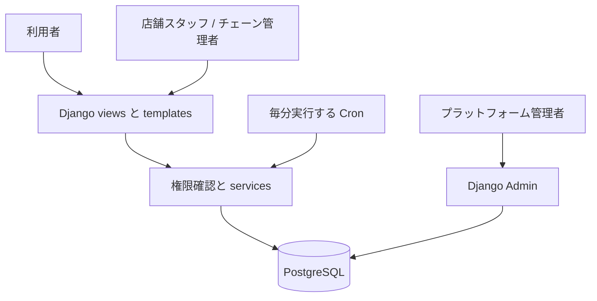
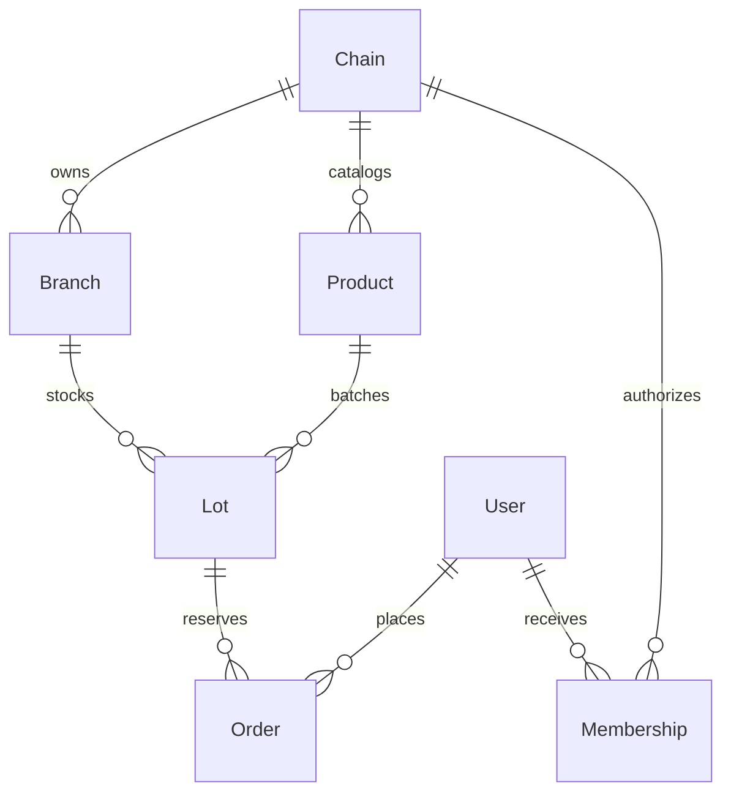

# Food Rescue — 食品ロス削減システム

> CI/CD の構成、AWS SSM + GitHub OIDC、production rollback の手順は [`ops/DEPLOYMENT.md`](ops/DEPLOYMENT.md) を参照してください。`DEPLOY_ENABLED` を有効にするまでは production deploy は実行されません。

> **現在の状態：Market MVP は Django モノリスとして実装済みです。**
> ロットの一覧・詳細、予約・キャンセル、ロット作成、入金確認、注文の期限切れ処理、Membership による権限管理は settings／URL に接続されています。
> 業務モデルと migration は作成済みです。ローカルデータベースで使用する前に `python manage.py migrate` を実行してください。SQLite の結果を、本番環境における同時実行安全性の根拠として扱わないでください。
> Phase 1–2 のトップ画面は `/products/` で独自のサンプルデータを使用し、Market 画面は `/` でデータベースのデータを使用します。

賞味期限・消費期限が近い食品をスーパーマーケットやコンビニエンスストアのチェーンが出品する Django アプリケーションです。利用者はオンラインで商品を予約し、指定した店舗で受け取り、店頭で支払います。MVP ではオンライン決済と配送を扱いません。

## 1. スコープと前提

- 既存プロジェクトに合わせ、画面表示には日本語を使用します。既定の通貨は JPY、タイムゾーンは Asia/Tokyo です。通貨単位は環境変数 `CURRENCY` で変更できます。
- 1 件の注文は、1 店舗にある 1 ロットを対象とし、数量は利用者が指定します。複数商品をまとめるカート機能は今後の対応です。
- 店舗スタッフはロットを手動で登録します。POS、ERP、期限情報の自動読み取りとは連携していません。
- ロットは販売が有効で、予約可能時間内にある場合に自動表示されます。予約締切 < 受取期限 ≤ 使用期限でなければなりません。
- 注文はロットの受取期限まで商品を確保します。利用者は受取期限前にキャンセルでき、期限を過ぎた注文はシステムが EXPIRED に変更します。
- 使用期限を過ぎた商品は、期限切れ注文の処理が遅れていても予約・受け渡しできません。
- 日付だけから食品の安全性を判断しません。販売側が商品情報、保管、アレルギー、回収に責任を持ちます。商品情報では use-by（消費期限）と best-before（賞味期限）を区別します。

## 2. ロールと権限

| ロール | 権限 |
|---|---|
| 利用者 | 会員登録、ログイン、商品検索、詳細確認、自分の注文の予約・キャンセル |
| 店舗スタッフ | チェーンの商品カタログからロットを作成、店舗の注文を確認、受取コードを使って支払いと商品受け渡しを確定 |
| チェーン管理者 | 割り当てられたチェーン配下の全店舗を運用し、その範囲のレポートを確認 |
| プラットフォーム管理者 | Django Admin でチェーン、店舗、商品、権限を管理し、すべての店舗を運用 |

MVP では、商品カタログ、店舗、権限をプラットフォーム管理者が管理します。チェーン管理者向けの組織・スタッフ管理画面は今後の拡張対象です。チェーン操作の権限付与に `is_staff` は使用せず、Admin は superuser だけが使用します。オブジェクト単位の権限はサーバー側で検証します。

## 3. アーキテクチャ

Django モノリス構成です。Templates + Forms + セッション認証 → views → トランザクションを扱う services → ORM → PostgreSQL という流れを採用します。SQLite はデモと機能テスト専用です。MVP では Redis／Celery を使用せず、cron から毎分 management command を呼び出して期限切れ注文を処理します。



## 4. データモデル

| テーブル | 主なデータ |
|---|---|
| User | Django auth、アカウント、ハッシュ化されたパスワード |
| Chain | チェーン名 |
| Branch | チェーン、店舗名、住所 |
| Membership | ユーザー、チェーン、店舗（空欄の場合はチェーン管理者） |
| Product | チェーン、商品名、説明、原材料／アレルギー、保管方法、期限種別、画像 URL |
| Lot | 商品、店舗、ロットコード、通常価格／割引価格、予約可能在庫、販売開始、予約締切、受取開始／終了、使用期限、販売有効フラグ |
| Order | 内部 UUID、利用者、ロット、数量、確定価格、受取コード UUID、状態、確定受取期限、予約／支払日時、受渡担当者 |



価格、数量、受取期限は注文作成時に確定して保存します。ロットの使用期限は商品受け渡し時にも必ず確認します。注文が存在するロットは Admin から編集できません。調整・回収には、本番公開前に専用の手順が必要です。取引履歴を保持するため、取引に関わるリレーションには PROTECT を使用します。

## 5. 業務フローと不変条件

1. 店舗スタッフは、権限を持つ店舗に対して有効なロットを作成し、同じチェーンの商品を選択します。
2. 利用者はキーワードや店舗で絞り込みます。販売中で、在庫があり、予約受付が終了していない商品だけが表示されます。
3. 予約の POST では、ログイン、CSRF、正の整数である数量を確認します。トランザクション内でロットをロックし、時間条件と在庫を確認したうえで、在庫減算と注文作成を同一トランザクションで実行します。同じフォームが再送された場合の重複注文を、UUID の request token で防止します。
4. 利用者は店舗で受取コードを提示します。スタッフはコード、受取可能時間、店舗権限、注文状態を確認し、店頭で代金を受け取った後に **入金確認・商品受け渡し済み** を確定します。自動決済は行いません。
5. キャンセル／EXPIRED への変更は RESERVED からのみ許可し、トランザクション内で在庫を一度だけ戻します。在庫が戻っても、販売時間外のロットは一覧に表示されません。

状態遷移は RESERVED → COLLECTED、CANCELLED、EXPIRED のいずれかです。`paid_at` と `collected_by` を持つのは COLLECTED だけです。状態を戻すことはできません。デッドロックを減らすため、Lot → Order の順にロックします。期限切れ処理は繰り返し実行しても安全です。価格には Decimal を使用し、float は使用しません。

## 6. 画面とエンドポイント

| Method / path | 目的 |
|---|---|
| GET / | ロットの一覧と検索 |
| GET /lots/<id>/ | 詳細、保管／アレルギー情報、予約フォーム |
| POST /lots/<id>/reserve/ | 商品を確保して注文を作成 |
| GET/POST /signup/ | 利用者の会員登録 |
| /accounts/login/ | ログイン |
| POST /accounts/logout/ | ログアウト |
| GET /orders/ | 利用者自身の注文一覧 |
| POST /orders/<uuid>/cancel/ | 利用者自身による注文キャンセル |
| GET /staff/ | 権限範囲内の注文と集計値 |
| GET/POST /staff/lots/new/ | ロット作成 |
| POST /staff/orders/<uuid>/collect/ | コード確認、入金確認、商品受け渡し確定 |
| /admin/ | プラットフォーム管理 |

MVP には公開 API／DRF はありません。上記フローを提供する、サーバー側で HTML をレンダリングするアプリケーションです。

## 7. 実行手順

Python 3.11 以上が必要です。

`market` は登録済みで、業務 migration、`seed_demo`、`expire_orders` は実装済みです。既存のアカウント用ソースコードと migration はそのまま保持しています。

```bash
python -m venv .venv
# Windows PowerShell: .venv\Scripts\Activate.ps1
# macOS/Linux: source .venv/bin/activate
python -m pip install -r requirements.txt
python manage.py migrate
python manage.py seed_demo
python manage.py createsuperuser
python manage.py runserver
```

http://127.0.0.1:8000 を開きます。`seed_demo` は商品サンプルデータを作成しますが、既定のアカウントやパスワードは作成しません。利用者は `/signup/` で登録します。スタッフ用アカウントには、`/admin/` で superuser が Membership を設定してください。チェーンと店舗を選択し、チェーン管理者にする場合は店舗を空欄にします。Membership を設定する前に、会員登録でアカウントを作成してください。

```bash
python manage.py test
python manage.py expire_orders
```

Linux の cron 例（実際のパスに置き換えてください）：`* * * * * /app/.venv/bin/python /app/manage.py expire_orders`。Windows では Task Scheduler を使用して毎分実行します。

## 8. PostgreSQL とデプロイ

既定の SQLite は開発用途に限ります。PostgreSQL に切り替えるには、`DB_NAME`、`DB_USER`、`DB_PASSWORD`、`DB_HOST`、`DB_PORT` を設定します。ランダムな `SECRET_KEY`、`DEBUG=0`、実際のホスト名を指定した `ALLOWED_HOSTS`、HTTPS origin を指定した `CSRF_TRUSTED_ORIGINS`、対象市場に合わせた `CURRENCY` と `TIME_ZONE` を設定してください。秘密情報をソースコードに保存しないでください。

本番環境には、WSGI サーバー（例：Gunicorn）、HTTPS リバースプロキシ、`collectstatic` とプロキシによる static 配信、cron、DB のバックアップ／リストア、集中ログ、エラー通知、プロキシ側でのログイン／予約回数制限が必要です。HTTPS が動作した後に `SECURE_SSL_REDIRECT=1` を設定します。プロキシヘッダーは、信頼できるプロキシを使用する場合にのみ設定してください。

Django の `select_for_update` には、対応するデータベースとトランザクションが必要です。SQLite は PostgreSQL と同等の行ロックを提供しません。公式ドキュメント：https://docs.djangoproject.com/en/5.2/ref/models/querysets/#select-for-update および https://docs.djangoproject.com/en/5.2/topics/db/transactions/ を参照してください。

## 9. テストと受け入れ基準

自動テストの対象は、在庫不足、予約締切、在庫確保、同一 request の再送、キャンセル時の一度だけの在庫復元、期限切れ、受取時間内の引き渡し、コード不一致、店舗権限、確定価格、利用者画面、スタッフ用フォームです。同時実行ロックのテストは PostgreSQL で別途実行します。SQLite の結果を、本番環境の race condition 対策の証明として扱いません。

受け入れフロー：利用者がロット情報を確認 → 予約 → 受取コードと合計金額を確認 → 正しい店舗のスタッフが入金を確認 → 注文が COLLECTED になります。別の利用者はその注文をキャンセルできず、別店舗のスタッフは商品を引き渡せません。期限超過後は予約も引き渡しもできません。

## 10. 制限事項とロードマップ

MVP には、メール／SMS、地図、複数商品カート、チェーン審査、POS 連携、商品回収対応、画像アップロード、メールによるパスワードリセット、アプリ内 rate limiting、削減できた食品重量／CO₂ のレポートはありません。画像 URL は管理者が入力し、サーバー側で画像をアップロードしません。レポートは COLLECTED の注文数と売上だけを集計し、救済した食品量を示すものではありません。

本番公開前に、PostgreSQL 上での負荷・race テスト、店舗による回収／キャンセル手順、POS との照合方法、受取コードの保護、チェーン情報の検証、バックアップ計画、利用者データの retention、セキュリティ確認、実運用確認が必要です。

## 11. Codex で開発を継続する際の指針

最初にこの README を読み、店頭支払いのフローを維持してください。在庫または注文状態の変更はすべて `market/services.py` を経由し、views／Admin から直接変更しないでください。Membership による権限管理を維持します。データモデルを変更する場合は migration と業務テストを追加してください。PostgreSQL、HTTPS、バックアップ、運用を検証するまでは production-ready と表明しないでください。`django-food-rescue` skill は、設計 → README → 実装 → テストの反復手順を示します。

## 12. 準備済みのディレクトリ構成

既存プロジェクトから開発を継続できるよう、各 Django app はルートディレクトリに配置します。業務領域ごとに分割し、この準備段階では microservices、API、バックグラウンドタスク基盤を追加しません。

**表記ルール：** `[既存]` は既存のソースコード／リソース、`[雛形]` はコメントだけを持ち、ロジックをまだ実装していない新規ファイルです。以下のツリーはアーキテクチャに関係する箇所に絞り、`.venv`、cache、既存画像・template の全件は記載しません。

```text
Project_Graduation/
├── manage.py                         [既存]
├── requirements.txt                  [既存]
├── README.md
├── config/
│   ├── __init__.py                   [既存]
│   ├── settings.py                   [既存、現在使用中の設定]
│   ├── urls.py                       [既存、現在使用中の URL]
│   ├── asgi.py                       [既存]
│   ├── wsgi.py                       [既存]
│   └── environments/                [雛形、未読込]
│       ├── __init__.py
│       ├── base.py
│       ├── development.py
│       ├── production.py
│       └── test.py
├── accounts/
│   ├── models.py, views.py, forms.py [既存]
│   ├── urls.py, decorators.py        [既存]
│   ├── apps.py, admin.py, tests.py   [既存]
│   ├── migrations/                  [既存]
│   ├── services.py                  [雛形]
│   └── selectors.py                 [雛形]
├── stores/
│   ├── models.py, admin.py           [Market MVP 向けに実装済み]
│   ├── views.py, urls.py, tests.py   [既存]
│   ├── migrations/                  [業務 migration 作成済み]
│   ├── forms.py                     [雛形]
│   ├── permissions.py               [実装済み]
│   └── selectors.py                 [実装済み]
├── products/
│   ├── models.py, admin.py           [Market MVP 向けに実装済み]
│   ├── views.py, urls.py, tests.py   [既存]
│   ├── migrations/                  [業務 migration 作成済み]
│   ├── forms.py                     [ロット用フォーム実装済み]
│   └── selectors.py                 [ロット検索実装済み]
├── reservations/
│   ├── models.py, admin.py           [Market MVP 向けに実装済み]
│   ├── views.py, urls.py, tests.py   [既存]
│   ├── migrations/                  [業務 migration 作成済み]
│   ├── forms.py                     [予約／受取フォーム実装済み]
│   └── selectors.py                 [注文検索実装済み]
├── market/                          [Market MVP 実装済み]
│   ├── __init__.py
│   ├── apps.py
│   ├── urls.py
│   ├── views.py
│   ├── forms.py
│   ├── selectors.py
│   ├── services.py
│   ├── context_processors.py
│   ├── tests.py
│   └── management/
│       ├── __init__.py
│       └── commands/
│           ├── __init__.py
│           ├── expire_orders.py
│           └── seed_demo.py
├── core/                            [既存、共通／サンプル画面]
├── templates/
│   ├── ...                          [既存 template を保持]
│   └── market/                      [実装済み]
│       ├── base.html
│       ├── lot_list.html
│       ├── lot_detail.html
│       ├── orders.html
│       ├── dashboard.html
│       ├── lot_form.html
│       ├── login.html
│       ├── signup.html
│       └── pagination.html
├── static/
│   ├── css/
│   │   ├── ...                      [既存 CSS]
│   │   └── market.css               [実装済み]
│   ├── js/                          [既存]
│   └── images/                      [既存]
└── tests/                           [すべて雛形]
    ├── __init__.py
    ├── integration/
    │   ├── __init__.py
    │   ├── test_customer_flow.py
    │   └── test_staff_flow.py
    └── concurrency/
        ├── __init__.py
        └── test_inventory.py
```

### 12.1. プロジェクト設定

| ファイル／ディレクトリ | 今後実装する内容 |
|---|---|
| `config/settings.py` | 現在の設定です。コードの実装開始後、Django の起動を確認してから環境別設定へ移行します。 |
| `config/environments/base.py` | apps、middleware、templates、言語、タイムゾーン、static、ログインに関する共通設定。 |
| `config/environments/development.py` | 開発端末、DEBUG、デモ用データベース、必要に応じた開発ツールの設定。 |
| `config/environments/production.py` | 環境変数、PostgreSQL、HTTPS、cookie、logging、運用設定。 |
| `config/environments/test.py` | テスト実行、テスト用データベース、データ分離に関する設定。 |
| `config/urls.py` | 今後、新しい画面、アカウント、Admin の URL を接続します。現在は既存 URL を保持します。 |
| `config/asgi.py`, `config/wsgi.py` | デプロイ先サーバーが使用するアプリケーションの起動点です。この段階では変更しません。 |

`config/settings.py` と `config/settings/` package が同時に存在して Python import が曖昧になることを避けるため、環境別設定の雛形は `environments/` に置きます。雛形ファイルは、現在動作中の設定をまだ継承・置換しません。

### 12.2. 業務 app

| App／ファイル | 想定する責務 |
|---|---|
| `accounts/` | アカウント、会員登録、ログイン、ユーザープロフィール。既存のアカウントデータを保持します。 |
| `accounts/services.py` | 会員登録／プロフィール更新の業務処理。在庫取引は扱いません。 |
| `accounts/selectors.py` | 再利用するアカウント／プロフィールの読み取りクエリ。 |
| `stores/models.py` | `Chain`、`Branch`、`Membership` を定義します。 |
| `stores/forms.py` | チェーン、店舗、スタッフ割り当ての入力検証。専用フォームが必要になった時点で追加します。 |
| `stores/permissions.py` | 店舗スタッフ、チェーン管理者、プラットフォーム管理者のオブジェクト単位の権限。 |
| `stores/selectors.py` | アクセス可能なチェーン／店舗を取得し、フォームと画面で共有するクエリ。 |
| `products/models.py` | `Product`、`Lot`、価格、数量、各時刻、データ制約を定義します。 |
| `products/forms.py` | ロット作成フォーム。同じチェーンの商品、価格、時刻を検証します。 |
| `products/selectors.py` | 販売中ロットの一覧、ロット詳細、検索、店舗絞り込み。 |
| `reservations/models.py` | `Order`、状態、確定価格／受取期限、受取コード、request token を定義します。 |
| `reservations/forms.py` | 予約データ、数量、重複防止 token、支払い／受け渡し確認。 |
| `reservations/selectors.py` | 利用者の注文、店舗権限内の注文、注文件数／売上レポート。 |
| `core/` | 既存の共通画面です。実装時に継続利用する画面を評価し、この段階では削除・変更しません。 |

各 app では、`apps.py` がアプリケーションを宣言し、`admin.py` が管理画面、`tests.py` が app 単位のテスト、`migrations/` がデータベース変更履歴を担当します。migration は model を実際に実装・変更した後にのみ作成します。既存の `views.py` と `urls.py` は保持し、今後、同じ業務処理が二重に存在しないよう意図的に新しいフローを `market` へ移します。

### 12.3. `market/` によるフロー調整

`market` は各業務 app を利用者／スタッフのフローとして接続します。model はデータを所有する app に置き、`market` で重複定義しません。

| ファイル | 現在の内容 |
|---|---|
| `apps.py` | `MarketConfig` を宣言し、settings へ app を登録します。 |
| `urls.py` | セクション 6 の endpoint をルーティングします。ログイン／会員登録 URL は `accounts` が所有します。 |
| `views.py` | request を受け、ログイン／権限を検証し、form、selectors、services を呼び出して render／redirect します。 |
| `forms.py` | 共通検索フォームを提供し、`products` と `reservations` の業務フォームを再利用して重複定義を避けます。 |
| `selectors.py` | 各 app の読み取りクエリを組み合わせて画面データを準備します。データベースは変更しません。 |
| `services.py` | ロット作成、在庫確保、注文キャンセル、期限切れ、商品受け渡し確認を処理します。transaction、在庫ロック、状態遷移、request の重複防止を一元管理します。 |
| `context_processors.py` | 通貨単位など、共通の表示用データを提供します。 |
| `tests.py` | 取引ルール、権限、時間条件、在庫、冪等性をテストします。 |
| `management/commands/expire_orders.py` | 期限切れ注文を batch 単位で処理し、services を呼び出します。cron／Task Scheduler から定期実行する想定です。 |
| `management/commands/seed_demo.py` | services を通じてデモデータを作成します。既定パスワードを作成せず、取引データを上書きしません。 |

`__init__.py` は Python package を示すだけで、package 読み込み時に業務処理を実行しません。

### 12.4. 画面とリソース

| ファイル | 現在の内容 |
|---|---|
| `templates/market/base.html` | 共通 HTML、ナビゲーション、コンテンツ領域、メッセージ。 |
| `templates/market/lot_list.html` | ロット一覧、検索、絞り込み。 |
| `templates/market/lot_detail.html` | 商品詳細、アレルギー、保管方法、期限、受取時間、予約フォーム。 |
| `templates/market/orders.html` | 利用者の注文、状態、合計金額、受取コード、キャンセルボタン。 |
| `templates/market/dashboard.html` | 権限範囲内の注文と集計値、店頭支払い／商品受け渡し確認フォーム。 |
| `templates/market/lot_form.html` | スタッフ用のロット作成画面。 |
| `templates/market/login.html`, `signup.html` | 認証画面。処理は `accounts` が担当します。 |
| `templates/market/pagination.html` | 共通ページネーション部品。 |
| `static/css/market.css` | 利用者／スタッフ向け Market 画面の responsive style。 |

Market template は実装済みで、データベースのデータを render します。Market 以外の既存 template、JavaScript、画像は保持しています。

### 12.5. app 間テストの雛形

| ファイル／ディレクトリ | 今後実装する内容 |
|---|---|
| `tests/integration/test_customer_flow.py` | 会員登録 → 商品検索 → 予約 → コード確認 → キャンセルのフロー。利用者が自分の注文だけを確認・操作できることを検証します。 |
| `tests/integration/test_staff_flow.py` | ロット作成 → 正しい店舗の注文確認 → 入金／受け渡し確定のフロー。権限超過を検証します。 |
| `tests/concurrency/test_inventory.py` | PostgreSQL 上で、同時予約、在庫超過防止、一度だけの在庫復元、token による重複予約防止を検証します。 |

現在の業務テストは `market/tests.py` に集約されています。app 間テストと PostgreSQL 同時実行テストの各ファイルは、まだ雛形です。`requirements-lock.txt` はありません。業務 migration は作成済みで、デモデータは `seed_demo` を明示的に実行した場合にだけ書き込まれます。

## 13. 構成作成後の開発原則

- **読み取りフロー：** URL → view → selector → ORM → template。共通クエリはデータを所有する app に置き、`market/selectors.py` は必要な場合だけ集約します。
- **書き込みフロー：** URL → view → form → service → ORM。management command からの操作を含め、在庫／注文状態の変更はすべて `market/services.py` を経由します。views または Admin から直接変更しません。
- **権限：** `stores/permissions.py` でサーバー側の Membership を検証します。画面上でボタンを非表示にすることだけに依存しません。
- **app の境界：** `stores` はチェーン／店舗／権限、`products` は商品／ロット、`reservations` は注文、`accounts` はアカウントを所有し、`market` がそれらの間の取引を調整します。
- **拡張：** 新しいコードには、実際の必要性に応じてページネーション、index、クエリ最適化を追加します。transaction を短く保ち、PostgreSQL 上で同時実行テストを行います。MVP に不要な基盤は追加しません。
- **業務実装の状態：** Market MVP の models、migrations、services、画面、SQLite 上のテストは実装済みです。PostgreSQL の同時実行ロックテストと本番環境設定は未実施です。

## 14. Phase 1–2 画面更新

`food_rescue_ui_refactor_phase12.zip` の画面ファイルを適用済みです。更新元の資料はローカルの `docs/ui-refactor-phase12.md` に保存し、`docs/` は Git の追跡対象外です。プロジェクトの仕様と構成は引き続きこの README に記載します。

- `/products/`：緑色の hero とサンプル紹介 card を持つトップ画面。既存の利用者ログイン確認を引き続き使用します。
- `/products/list/`：予約可能な Market データの一覧。商品／店舗名の検索、店舗絞り込み、ページネーション、空状態、ロット詳細へのリンクに対応します。
- `products/templates/products/top.html`：hero、検索、商品、利用方法を示す `products/templates/products/partials/` 内の 4 つの partial を組み合わせます。
- `static/css/common.css`：トップ画面の共通 UI。`static/css/top.css`：トップ画面のコンテンツレイアウト。`static/js/top.js`：サンプル card の絞り込み、位置情報メッセージ、代替画像。
- `/stores/` と `/stores/product/new/`：`shop_base.html` と `static/css/stores.css` を使用するサンプル画面。未実装の機能を明示します。
- この画面版では ZIP に合わせて日本語と円のサンプル価格を使用します。上記の業務仕様にある言語／通貨は、今後の実装でも維持する要件です。

トップ画面 `/products/` の商品、店舗名、価格、割引率は引き続き UI 用サンプルデータです。そこでの検索／カテゴリは既存 card の絞り込みだけを行い、位置情報 API には接続していません。`/` の Market フローはデータベースのデータを使用し、ロット、予約／キャンセル、在庫、使用期限、店頭受取の処理を実装済みです。

static file と設定の確認：

```powershell
python manage.py findstatic css/common.css css/top.css css/stores.css js/top.js
python manage.py check
```

トップ画面を確認するには、server を起動し、既存の利用者アカウントでログインして `/products/` を開いてください。
